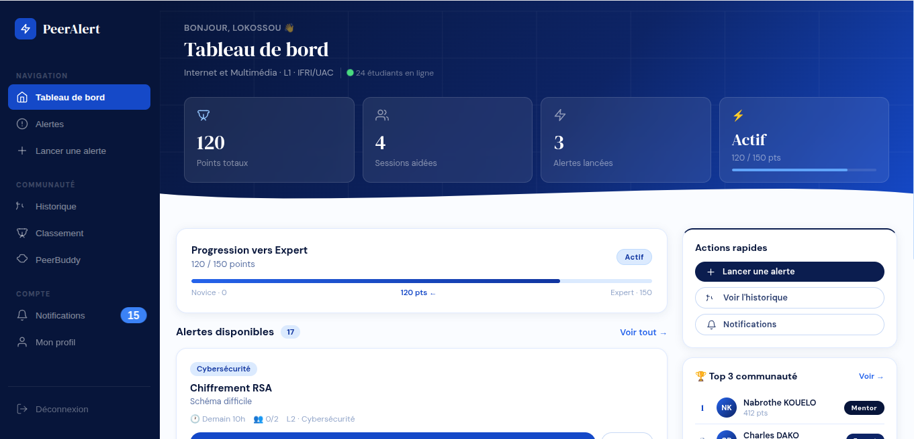
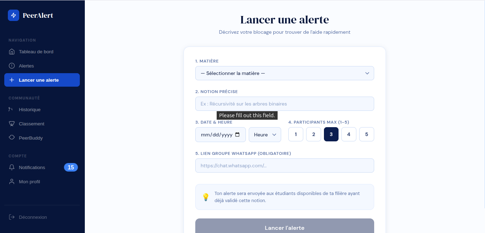
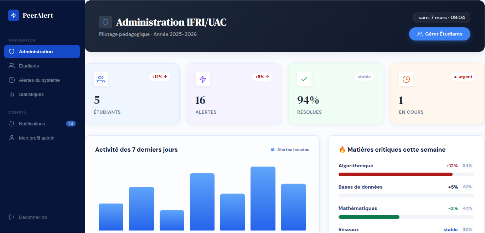

# ⚡ PeerAlert

<div align="center">


**Plateforme d'entraide peer-to-peer pour les étudiants de l'IFRI/UAC**

[](https://reactjs.org/)
[](https://vitejs.dev/)
[](https://supabase.com/)
[](https://tailwindcss.com/)

[🚀 Démo live](#) · [📖 Documentation](#) · [🐛 Signaler un bug](https://github.com/HackByIFRI-2026/V-LEAD_HACKBYIFRI_2026/issues)

</div>

---

## 📌 À propos

**PeerAlert** est une plateforme collaborative qui permet aux étudiants de l'IFRI/UAC de s'entraider en temps réel. Lorsqu'un étudiant bloque sur un exercice ou ne comprend pas une notion, il lance une **alerte** — et ses pairs ayant maîtrisé le sujet peuvent répondre.

> *"Personne ne devrait bloquer seul sur un exercice quand la solution se trouve à quelques mètres."*

---

## ✨ Fonctionnalités principales

### 🆘 Système d'alertes
- Lancer une alerte en précisant la matière, la notion et le créneau
- Rejoindre une alerte en tant qu'**Expert** ou **Apprenant**
- Validation du niveau Expert par quiz avant d'aider
- Décompte en temps réel avant chaque session

### 🧠 Validation intelligente des sessions
- Quiz de fin de session différencié selon le rôle :
  - **Apprenant / Créateur** → 3 questions · max 30 pts
  - **Expert** → 5 questions · max 60 pts
- Système anti-triche : copier/coller désactivé, pause si l'app perd le focus

### 🏆 Gamification
| Badge | Points requis | Icône |
|-------|--------------|-------|
| Novice | 0 – 49 pts | 🌱 |
| Actif | 50 – 149 pts | ⚡ |
| Expert | 150 – 299 pts | 🎯 |
| Mentor | 300+ pts | 👑 |

### 🤖 PeerBuddy
Assistant psychologique intégré pour accompagner les étudiants : gestion du stress, motivation, bien-être académique.

### 🛡️ Espace Administration
- Tableau de bord de pilotage pédagogique
- Import de la liste des étudiants via CSV
- Statistiques en temps réel : taux de résolution, matières critiques, activité hebdomadaire

---

## 🖼️ Aperçu

| Tableau de bord | Page Alertes | Dashboard Admin |
|:-:|:-:|:-:|
|  |  |  |

---

## 🛠️ Stack technique

```
Frontend       →  React.js + Vite
Styling        →  Tailwind CSS + CSS Variables
Backend        →  Supabase (PostgreSQL + Auth + Realtime)
Sécurité       →  Row Level Security (RLS)
Dev assistant  →  Gemini CLI
Versioning     →  Git + GitHub
```

---

## 🚀 Installation et lancement

### Prérequis
- Node.js ≥ 18
- npm ≥ 9
- Un compte [Supabase](https://supabase.com)

### 1. Cloner le projet
```bash
git clone https://github.com/HackByIFRI-2026/V-LEAD_HACKBYIFRI_2026.git
cd V-LEAD_HACKBYIFRI_2026
```

### 2. Installer les dépendances
```bash
npm install
```

### 3. Configurer les variables d'environnement
```bash
cp .env.example .env
```

Renseigne tes clés dans `.env` :
```env
VITE_SUPABASE_URL=https://ton-projet.supabase.co
VITE_SUPABASE_ANON_KEY=ta_clé_anon
```

### 4. Initialiser la base de données
Exécute le fichier `supabase/schema.sql` dans le SQL Editor de Supabase.

### 5. Lancer l'application
```bash
npm run dev
```

Ouvre [http://localhost:5173](http://localhost:5173)

---

## 🔐 Accès de démonstration

Des comptes de démonstration (administrateur et étudiant) permettent de tester la plateforme. Pour des raisons de sécurité, les identifiants ne sont pas publiés dans ce dépôt : ils sont fournis sur demande par l'équipe.

---

## 📁 Structure du projet

```
peeralert/
├── public/
│   └── sw.js              # Service Worker (notifications)
├── src/
│   ├── components/        # Composants réutilisables
│   ├── context/           # AppContext (state global)
│   ├── data/              # Données mockées
│   ├── pages/             # Pages de l'application
│   │   ├── DashboardPage.jsx
│   │   ├── AlertsPage.jsx
│   │   ├── ProfilePage.jsx
│   │   ├── AdminPage.jsx
│   │   └── ...
│   ├── services/          # Logique métier + Supabase
│   ├── utils/             # Icônes, helpers, chatbot
│   └── App.jsx
├── supabase/
│   └── schema.sql         # Schéma de la base de données
├── .env.example
└── README.md
```

---

## 🗄️ Schéma de base de données

```
profiles          → Profils étudiants (badge, points, dispo)
alerts            → Alertes d'entraide
alert_participants → Qui a rejoint quelle alerte et en quel rôle
notifications     → Notifications utilisateur
authorized_students → Whitelist des étudiants autorisés
```

---

## 👥 Équipe V-LEAD

| Membre | Filière | Rôle |
|--------|---------|------|
| **LOKOSSOU John Elie** | Internet et Multimédia | Chef de projet |
| **KOUELO Nabrothe Bel-Mira** | Génie Logiciel | Développement |
| **DAKO Charles Aurel** | Cybersécurité | Sécurité & Backend |
| **ADJATI Elvina Kaylhia** | SEIoT | Frontend & Design |
| **TOVIHOUANDE Victoria Gloria** | Intelligence Artificielle | IA & PeerBuddy |

---


## 📄 Licence

Ce projet est développé dans le cadre académique de l'**IFRI/UAC** (Institut de Formation et de Recherche en Informatique, Université d'Abomey-Calavi).

---

<div align="center">

Fait avec ❤️ par l'équipe **V-LEAD** · IFRI/UAC · 2026

</div>
